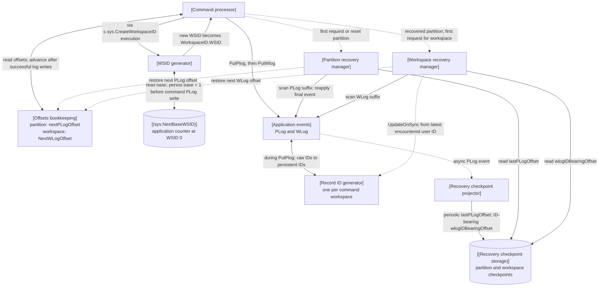
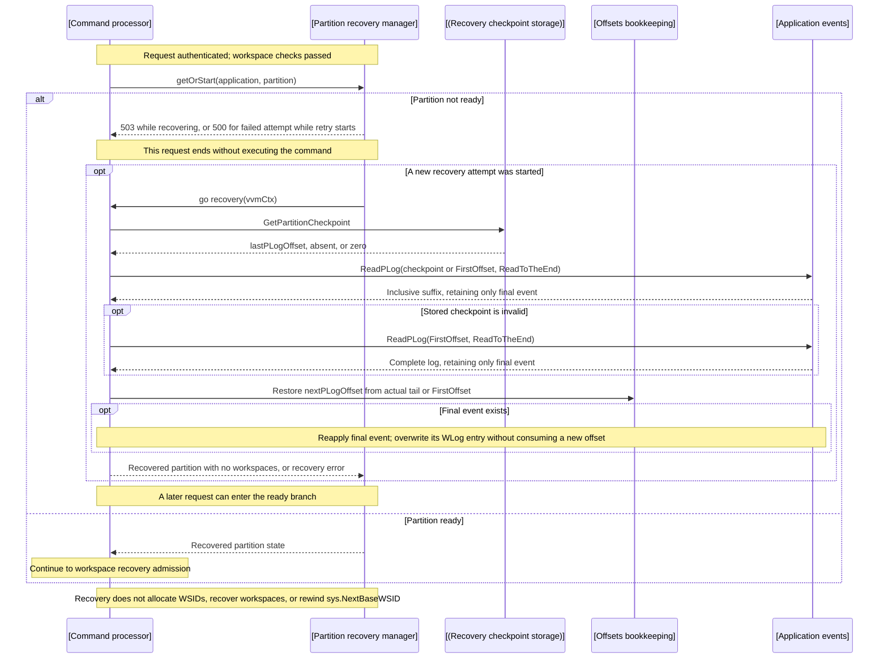
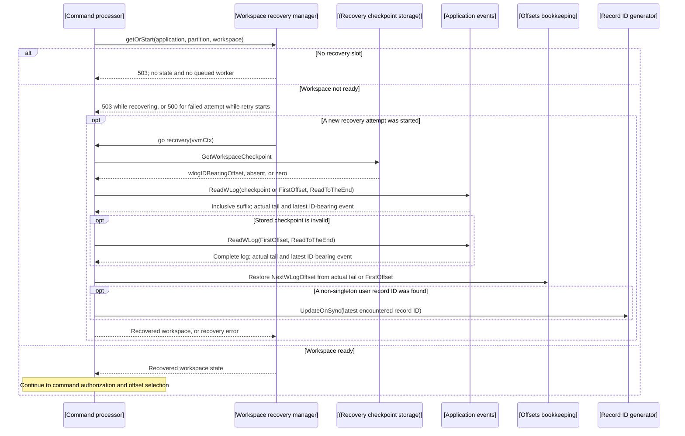
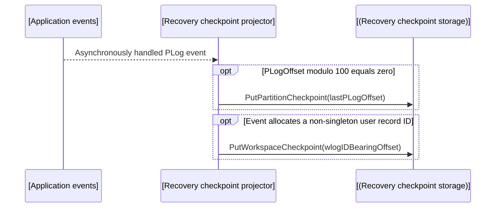
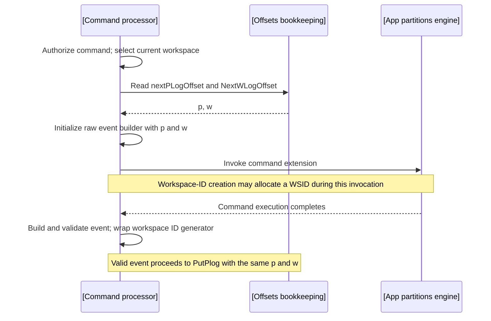
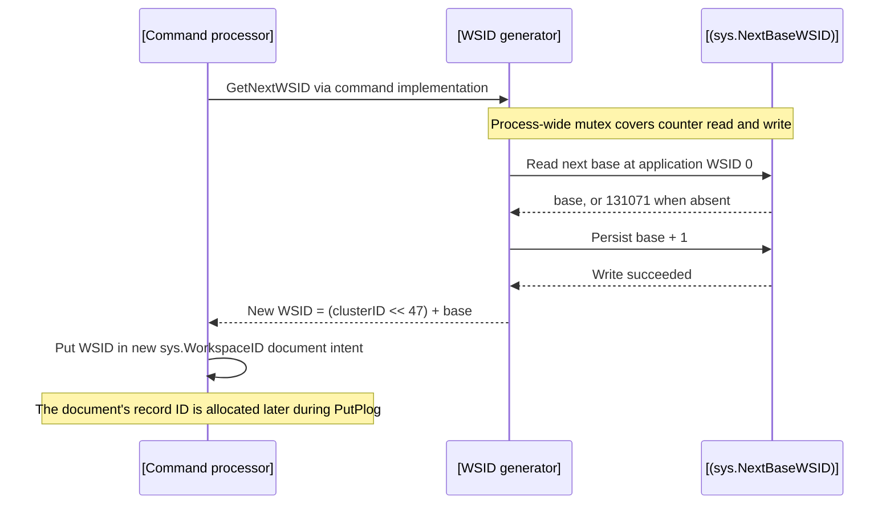
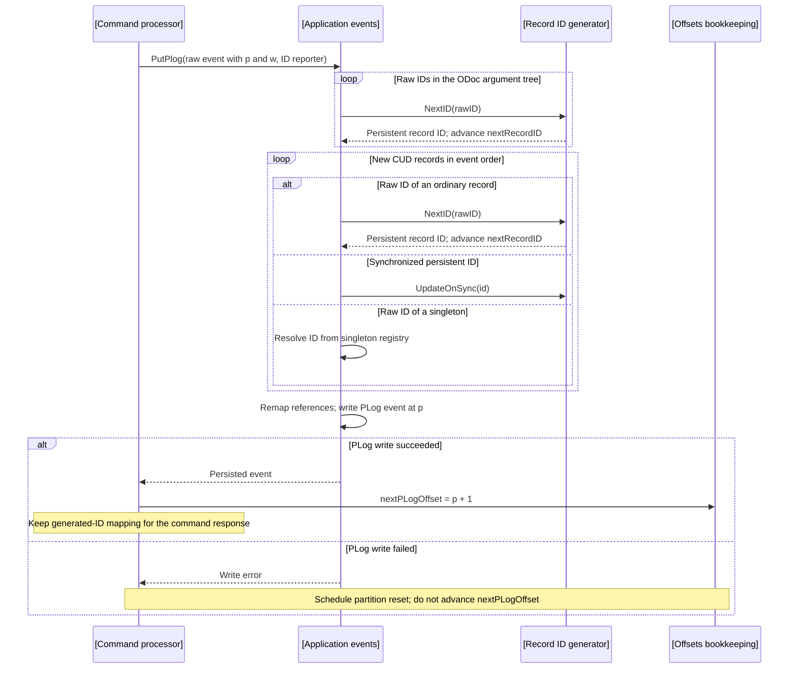
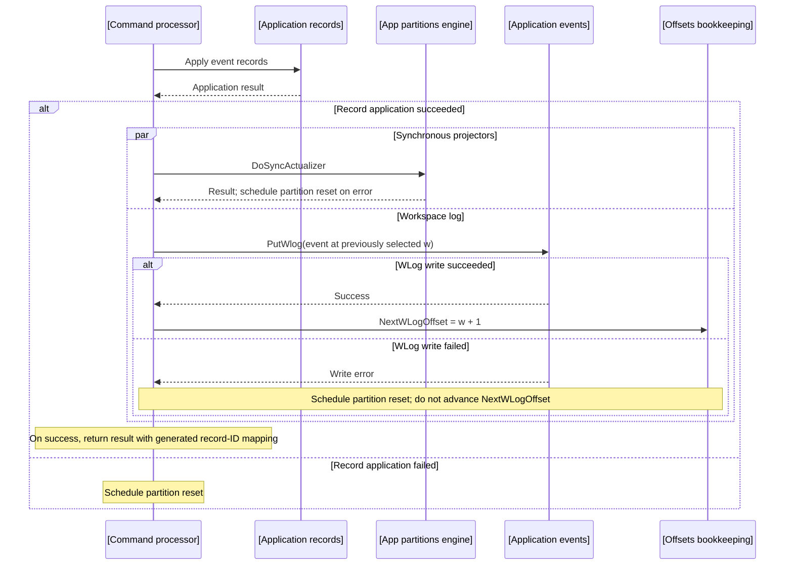
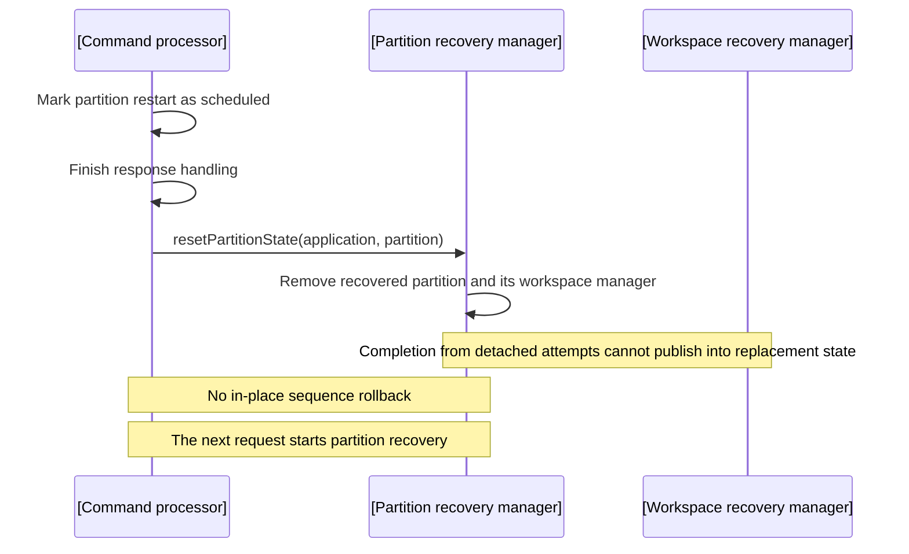

# Context subsystem architecture: prod/apps/sequences

Sequence allocation and recovery in the [apps context](./arch.md). The Command Processor keeps partition PLog offsets and workspace WLog offsets and record-ID generators in memory. It restores partition state from a checkpointed PLog suffix and restores each workspace lazily from a checkpointed WLog suffix. Workspace creation allocates WSIDs separately, using a persistent application-level counter in `sys.NextBaseWSID`.

## External actors

Systems:

- `*Client`
  - Invokes application commands through the request processing pipeline.

## Components

### Layers

```text
External actors
    |
    +-- *Client
    |
    v
Command sequencing
    |
    +-- [Command processor]
    +-- [Partition recovery manager]
    +-- [Workspace recovery manager]
    +-- [Offsets bookkeeping]
    +-- [Record ID generator]
    +-- [WSID generator]
    |
    v
Recovery checkpoints
    |
    +-- [Recovery checkpoint projector]
    +-- [(Recovery checkpoint storage)]
    |
    v
Application operations
    |
    +-- [Application events]
    +-- [Application records]
    +-- [App partitions engine]
    +-- [(sys.NextBaseWSID)]
```

#### Allocation and recovery relationships

- Solid: calls and data flow
- Dashed: recovery triggers and restoration of in-memory state.



The generated WSID is a field of a new `sys.WorkspaceID` document. That document also receives a separate record ID from the generator in the **current command workspace**. Its PLog and WLog offsets likewise belong to the current command's partition/workspace, not the newly allocated workspace.

The WSID counter is written directly before the command event is persisted, so a later command failure can leave a gap in allocated WSIDs. Partition and workspace recovery restore their own offset and record-ID state from events; neither rebuilds or rolls back the WSID counter.

### Command sequencing

- `[Command processor]`
  - Owns the command pipeline, `[Offsets bookkeeping]`, and `[Record ID generator]` instances. General command execution is described in [Processing](./arch-processing.md).
  - The ID reporter wraps the workspace generator to collect raw-to-persistent IDs for the command response.
  - impl: [pkg/processors/command/provide.go](../../../../pkg/processors/command/provide.go)
  - impl: [pkg/processors/command/impl.go](../../../../pkg/processors/command/impl.go)

- `[Partition recovery manager]`
  - Owns partition states keyed by application QName and partition ID: absent, recovering, recovered, or failed. Concurrent requests for one key share one attempt; partition recovery itself has no configured concurrency limit.
  - Reads `lastPLogOffset`, scans the PLog inclusively through the actual tail, restores only `nextPLogOffset`, and reapplies the final returned event. It publishes a partition with an empty `[Workspace recovery manager]`; it never reconstructs workspaces from the PLog scan.
  - A workpiece associated with the triggering request is detached only after recovery admission, sent to the reapply-last-event sub-pipeline, and released after the attempt. A write or record-application failure removes the published partition so a later request starts a fresh recovery.
  - A failed attempt remains recorded. The next request starts one retry and receives the retained failure; requests made while an attempt runs receive `503` and do not start another worker.
  - Recovery uses the service context. Reset detaches the current state so completion of an older attempt cannot publish into a replacement state; service shutdown cancels attempts and joins recovery workers before closing command pipelines.
  - Recovery logs use `sys._Recovery`, `partid`, and the platform VApp attributes. They include checkpoint validation, read, reapply, start, and completion events. Log conventions are defined in [Logging](./logging--td.md).
  - decl: [pkg/processors/command/types.go](../../../../pkg/processors/command/types.go)
  - impl: [pkg/processors/command/impl.go](../../../../pkg/processors/command/impl.go)
  - impl: [pkg/processors/command/recovery_manager.go](../../../../pkg/processors/command/recovery_manager.go)
  - Evidence: recovery scenarios in [command tests](../../../../pkg/processors/command/impl_test.go) and generic lifecycle coverage in [recovery-manager tests](../../../../pkg/processors/command/recovery_manager_test.go).

- `[Workspace recovery manager]`
  - Lives inside one recovered application partition and owns workspace states keyed by application QName, partition ID, and WSID: absent, recovering, recovered, or failed.
  - Starts recovery only when a command reaches the workspace stage after partition recovery. Concurrent requests for one workspace share one attempt; recovered workspaces are reused immediately.
  - Shares exactly `NumWSRecoverers` slots per partition. A request that cannot reserve a slot receives `503`; no state or waiting goroutine is created, so a later request must retry admission. An explicit zero admits no workspace recovery; the default is four.
  - Reads `wlogIDBearingOffset`, scans the WLog inclusively through the actual tail, restores `NextWLogOffset`, and advances the workspace `[Record ID generator]` from the latest event in the suffix that allocates non-singleton user IDs.
  - Retains failure, retry, stale-completion, service-context, and shutdown semantics from the generic recovery lifecycle used by `[Partition recovery manager]`.
  - Recovery logs add `wsid` to the partition recovery attributes and use the workspace start, checkpoint-validation, read, completion, admission, and failure stages defined in [Logging](./logging--td.md).
  - decl: [pkg/processors/command/types.go](../../../../pkg/processors/command/types.go)
  - impl: [pkg/processors/command/impl.go](../../../../pkg/processors/command/impl.go)
  - impl: [pkg/processors/command/recovery_manager.go](../../../../pkg/processors/command/recovery_manager.go)
  - Evidence: workspace recovery and admission scenarios in [command tests](../../../../pkg/processors/command/impl_test.go), generic lifecycle coverage in [recovery-manager tests](../../../../pkg/processors/command/recovery_manager_test.go), and restart scenarios in [VIT recovery tests](../../../../pkg/sys/it/impl_recovery_test.go).

- `[Offsets bookkeeping]`
  - The Command Processor's in-memory fields, rather than a separate service: `appPartition.nextPLogOffset` is per application/partition; `workspace.NextWLogOffset` is per application/workspace. Both start at `FirstOffset`.
  - Values are copied into the raw event before command execution. A successful PLog write increments the partition offset; a successful WLog write increments the workspace offset. Partition recovery restores the PLog offset from the actual PLog tail; lazy workspace recovery restores the WLog offset from the actual WLog tail.
  - impl: [pkg/processors/command/provide.go](../../../../pkg/processors/command/provide.go)
  - impl: [pkg/processors/command/impl.go](../../../../pkg/processors/command/impl.go)

- `[Record ID generator]`
  - One incrementing generator per workspace serves all ordinary record kinds. `NextID` returns the current next ID and increments it. `UpdateOnSync(id)` advances to `id + 1` only when `id` is at least the current next value.
  - Singleton IDs come from the application singleton registry, bypassing this ordinary allocation sequence.
  - impl: [pkg/istructsmem/idgenerator.go](../../../../pkg/istructsmem/idgenerator.go)
  - impl: [pkg/istructsmem/internal/singletons/impl.go](../../../../pkg/istructsmem/internal/singletons/impl.go)
  - Evidence: `TestIDGenerator` in [ID generator tests](../../../../pkg/istructsmem/idgenerator_test.go).

- `[WSID generator]`
  - `workspace.GetNextWSID` is called from the `c.sys.CreateWorkspaceID` command implementation, invoked through `[App partitions engine]` during command execution.
  - Under the process-wide `nextWSIDGlobalLock`, reads `[(sys.NextBaseWSID)]`, uses `FirstBaseUserWSID` (131071) when absent, and persists base + 1 before returning `(ClusterID << 47) + base`. The cluster ID comes from the command workspace.
  - The counter lock is process-local; the implementation explicitly leaves coordination across multiple VVMs unresolved.
  - impl: [pkg/sys/workspace/impl.go](../../../../pkg/sys/workspace/impl.go)
  - impl: [pkg/sys/workspace/utils.go](../../../../pkg/sys/workspace/utils.go)
  - WSID layout and starting value: [istructs utilities](../../../../pkg/istructs/utils.go), [istructs constants](../../../../pkg/istructs/consts.go).

#### Active numbering state

| Value | Scope | Initial next value | Advancement |
| --- | --- | --- | --- |
| PLog offset | Application and partition | `FirstOffset` (1) | Successful PLog write; actual recovered PLog-tail offset + 1 |
| WLog offset | Application and workspace | `FirstOffset` (1) | Successful WLog write; actual recovered WLog-tail offset + 1 |
| Ordinary record ID | Application and workspace | `FirstUserRecordID` (200001) | Each generated ID; synchronized ID or the latest recovered ID-bearing event can advance the generator |
| Base WSID | Application, persisted under WSID 0 | 131071 | Direct view write of base + 1 during workspace-ID creation |

Record ID ranges are defined in [istructs constants](../../../../pkg/istructs/consts.go):

| Range | Meaning |
| --- | --- |
| 0 | Null ID |
| 1–65535 | Raw IDs to be replaced before persistence |
| 65536–200000 | Reserved IDs |
| 65536–66047 | Singleton IDs within the reserved range |
| 66048 | `NonExistingRecordID` test sentinel |
| 200001 onward | Ordinary generated IDs |

These are scoped identifiers, not globally unique numbers across applications or workspaces.

### Recovery checkpoints

- `[Recovery checkpoint projector]`
  - One built-in asynchronous projector, `sys.ProjectorRecoveryCheckpoint`, observes PLog events for every application.
  - When `PLogOffset % 100 == 0`, it stores `{"lastPLogOffset": <offset>}` for the event's application and handling partition.
  - When an event allocates at least one new non-singleton record ID at or above `FirstUserRecordID`, it stores `{"wlogIDBearingOffset": <offset>}` for the event's application and workspace. Singleton creation, updates of existing records, and CUD-free events do not update this checkpoint.
  - A later projector write may replace an earlier valid ID-bearing offset, but recovery correctness does not require the stored offset to be the latest ID-bearing event.
  - decl: [pkg/checkpoints/consts.go](../../../../pkg/checkpoints/consts.go)
  - impl: [pkg/checkpoints/provide.go](../../../../pkg/checkpoints/provide.go)
  - impl: [pkg/checkpoints/impl.go](../../../../pkg/checkpoints/impl.go)
  - Evidence: [checkpoint projector tests](../../../../pkg/checkpoints/impl_test.go).

- `[(Recovery checkpoint storage)]`
  - Implements `IRecoveryCheckpointStorage` in `sys/vvm` storage. Partition and workspace checkpoints are independent last-write-wins JSON records; recovery never updates either record.
  - A partition record is keyed by the sequence-partition prefix, cluster application ID, and partition ID. A workspace record is keyed by the sequence-workspace prefix, cluster application ID, and WSID. Both use the singleton clustering column `[]byte{1}`.
  - `lastPLogOffset` is the last PLog offset handled when the partition checkpoint was written and is an inclusive partition-recovery scan start.
  - `wlogIDBearingOffset` identifies any existing WLog event that allocated a non-singleton user record ID. It is only an inclusive workspace-recovery scan start: it is not authoritative record-ID state, is not the last WLog offset, and need not identify the latest ID-bearing event.
  - decl: [pkg/checkpoints/types.go](../../../../pkg/checkpoints/types.go)
  - impl: [pkg/vvm/storage/impl_recoverycheckpoint.go](../../../../pkg/vvm/storage/impl_recoverycheckpoint.go)
  - Evidence: [checkpoint storage tests](../../../../pkg/vvm/storage/impl_recoverycheckpoint_test.go).

### Application operations

- `[Application events]`
  - Implements PLog/WLog storage through `IEvents`. Before persisting a valid event, regenerates raw IDs in document arguments and CUDs. Partition recovery reads PLog suffixes; workspace recovery reads WLog suffixes. Owns the event side of sequence trust enforcement.
  - decl: [pkg/istructs/interface.go](../../../../pkg/istructs/interface.go)
  - impl: [pkg/istructsmem/impl.go](../../../../pkg/istructsmem/impl.go)
  - impl: [pkg/istructsmem/event-types.go](../../../../pkg/istructsmem/event-types.go)

- `[Application records]`
  - Applies CUDs and enforces the record side of sequence trust. The event reapplier uses the same record application path in reapply mode, and overwrites the last event's WLog entry.
  - impl: [pkg/istructsmem/impl.go](../../../../pkg/istructsmem/impl.go)

- `[App partitions engine]`
  - Supplies the borrowed partition, invokes command extensions through `Invoke`, and executes synchronous projectors through `DoSyncActualizer`.
  - decl: [pkg/appparts/interface.go](../../../../pkg/appparts/interface.go)
  - impl: [pkg/appparts/impl.go](../../../../pkg/appparts/impl.go)
  - impl: [pkg/appparts/impl_app.go](../../../../pkg/appparts/impl_app.go)
  - Projector processing details: [Processing](./arch-processing.md).

- `[(sys.NextBaseWSID)]`
  - One persistent next-base counter per application, accessed through `IAppStructs.ViewRecords()` at `NullWSID` (0), with both dummy key fields set to 1. This view stores WSID allocation state independently of the Command Processor's recovered workspace state.
  - decl: [pkg/appdef/sys/sys.go](../../../../pkg/appdef/sys/sys.go)
  - impl: [pkg/sys/workspace/utils.go](../../../../pkg/sys/workspace/utils.go)

#### Active write policy

`VVMConfig.SequencesTrustLevel` defaults to level 0. [VVM wiring](../../../../pkg/vvm/wire_gen.go) passes it through [the application structs provider](../../../../pkg/vvm/provide.go) to `istructsmem`; see [configuration defaults](../../../../pkg/vvm/impl_cfg.go).

| Trust level | Ordinary PLog/WLog writes | New table records | Existing table records |
| --- | --- | --- | --- |
| 0 | `InsertIfNotExists` | `InsertIfNotExists` | `Put` |
| 1 | `InsertIfNotExists` | `PutBatch` | `PutBatch` |
| 2 | `Put` | `PutBatch` | `PutBatch` |

A conditional-write collision returns `ErrSequencesViolation`; invalid trust-level values panic. Events marked `sys.Corrupted` use `Put` regardless of level. Last-event reapplication uses unconditional record batch writes and a WLog `Put`, allowing replay of data that may already have been applied. It does not allocate a new PLog offset.

Evidence: `TestSequencesTrustLevel` and `TestEventReapplier` in [write-policy tests](../../../../pkg/istructsmem/impl_seqtrust_test.go).

## Scenarios

### Allocate and persist a command

This flow starts with a recovered partition and workspace. Partition and workspace recovery admission are described in the following scenarios; general authorization and extension execution remain in [Processing](./arch-processing.md).

```text
*Client
  -> [Command processor]: command for application, partition, workspace
      - select workspace; snapshot next PLog and WLog offsets into raw event
      - execute and validate command
      -> [Application events]: PutPlog(raw event, ID reporter)
          -> [Record ID generator]: allocate raw argument and CUD IDs
          - remap record references; persist event
      - on successful PLog write: increment nextPLogOffset
      -> [Application records]: apply event CUDs
      - fork after record application:
          -> [App partitions engine]: DoSyncActualizer
          -> [Application events]: PutWlog
              - on success: increment workspace.NextWLogOffset
      -> *Client: command result with generated ID mapping
```

ODoc IDs are regenerated recursively before CUD IDs. Raw IDs and references within each structure are replaced using its regeneration map. New CUDs with supplied persistent IDs call `UpdateOnSync`; raw singleton CUD IDs resolve through the singleton registry instead of consuming the workspace generator. During recovery, ODoc root and descendant IDs also advance the generator, as described below.

A PLog write failure sets the partition restart flag; record-application, synchronous-projector, and WLog failures do likewise. After handling the command, the processor removes that partition's recovered state so the next request starts recovery. Sequence allocation is not an independently committed transaction that can be rolled back in place.

Implementation: [command pipeline](../../../../pkg/processors/command/provide.go), [allocation and PLog handling](../../../../pkg/processors/command/impl.go), [ID regeneration](../../../../pkg/istructsmem/event-types.go).

### Recover a partition and admit commands

Authentication and workspace checks precede recovery-state lookup. Command authorization follows recovery admission; starting recovery does not grant permission to execute a command.

```text
*Client
  -> [Command processor]: command
      - authenticate and check workspace
      -> [Partition recovery manager]: getOrStart(application, partition)
          - absent: transfer borrowed partition to worker; start recovery; return 503
          - recovering: return 503
          - failed: capture failure; start a retry worker; return prior failure as 500
          - recovered: return partition state; continue to workspace recovery admission

[Partition recovery manager]: background worker, service context
  -> [(Recovery checkpoint storage)]: GetPartitionCheckpoint(application, partition)
      - startOffset = lastPLogOffset when present and nonzero; otherwise FirstOffset
  -> [Application events]: ReadPLog(startOffset, ReadToTheEnd)
      - when validating a checkpoint, require the first returned offset to equal startOffset
      - retain only the final event and actual final offset
      - no callback or a different first offset makes a stored checkpoint invalid
  - invalid checkpoint: log error; repeat ReadPLog(FirstOffset, ReadToTheEnd) once
  - empty scan: nextPLogOffset = FirstOffset; publish without reapplication
  - non-empty scan: nextPLogOffset = actual final offset + 1
      - reapply only the final event:
          -> [Application records]: reapply last event's records
          - fork:
              -> [App partitions engine]: reapply synchronous projectors
              -> [Application events]: overwrite last WLog entry
  - publish partition with no recovered workspaces; release borrowed partition
```

The first admissible request receives `503 "partition N: recovery is in progress"` even when the PLog is empty. After a failed attempt, the triggering retry request receives `500 "partition N: recovery failed: ..."`; subsequent requests receive `503` until the new attempt finishes. Recovery is not retried on a background timer.

While a partition state is recovering, additional requests reuse that attempt instead of scheduling another worker. Other partitions can recover and process commands while it runs. Request cancellation does not cancel recovery: the scan and synchronous reapplication use the service/VVM context. A stored checkpoint causes at most one suffix scan and one fallback scan; recovery does not rewrite the checkpoint. Partition recovery never scans WLogs or starts workspace recovery.

Evidence: [command recovery tests](../../../../pkg/processors/command/impl_test.go), [recovery-manager tests](../../../../pkg/processors/command/recovery_manager_test.go), and [VIT checkpoint recovery tests](../../../../pkg/sys/it/impl_recovery_test.go).

### Recover a workspace and admit commands

Workspace admission runs only after partition recovery has published the containing application partition. It is lazy: the partition recovery worker does not enumerate or reconstruct workspace state.

```text
*Client
  -> [Command processor]: command for a recovered partition and workspace
      -> [Workspace recovery manager]: getOrStart(application, partition, workspace)
          - absent and slot available: reserve slot; start recovery; return 503
          - absent and no slot: return 503 without state or queued worker
          - recovering: return 503 and share the running attempt
          - failed and slot available: capture failure; start one retry; return prior failure as 500
          - recovered: return workspace state; continue command pipeline

[Workspace recovery manager]: background worker, service context
  -> [(Recovery checkpoint storage)]: GetWorkspaceCheckpoint(application, workspace)
      - startOffset = wlogIDBearingOffset when present and nonzero; otherwise FirstOffset
  -> [Application events]: ReadWLog(startOffset, ReadToTheEnd)
      - when validating a checkpoint, require the first returned offset to equal startOffset
      - require the checkpoint event to allocate a non-singleton user record ID
      - retain the actual final event offset
      - from each ID-bearing event, retain its greatest new non-singleton user record ID
      - retain the value from the latest encountered ID-bearing event
  - invalid checkpoint: log error; repeat ReadWLog(FirstOffset, ReadToTheEnd) once
  - nextWLogOffset = actual final offset + 1, or FirstOffset for an empty complete scan
  - nextRecordID = latest retained record ID + 1, or FirstUserRecordID when none was found
      -> [Record ID generator]: UpdateOnSync(latest retained record ID), when present
  - publish workspace; release recovery slot
```

`wlogIDBearingOffset` is validated only as an existing ID-bearing scan start. Recovery must read through the actual tail because the checkpoint need not identify either the latest ID-bearing event or the last WLog event. Singleton-only, existing-record, and CUD-free suffix events advance only the recovered WLog offset. A stored checkpoint causes at most one suffix scan and one fallback scan; recovery does not rewrite it.

`NumWSRecoverers` is the exact per-partition bound. A saturated manager does not queue work, and zero prevents recovery of any new workspace. Failed attempts remain associated with their workspace until a later request can reserve a slot and start one retry.

Evidence: workspace scenarios in [command recovery tests](../../../../pkg/processors/command/impl_test.go), generic admission and stale-completion coverage in [recovery-manager tests](../../../../pkg/processors/command/recovery_manager_test.go), and non-empty-log restart scenarios in [VIT checkpoint recovery tests](../../../../pkg/sys/it/impl_recovery_test.go).

### Produce recovery checkpoints

```text
[Application events]: asynchronously handled PLog event
  -> [Recovery checkpoint projector]: sys.ProjectorRecoveryCheckpoint
      - if PLogOffset % 100 == 0:
          -> [(Recovery checkpoint storage)]: PutPartitionCheckpoint(lastPLogOffset)
      - if event allocates a non-singleton user record ID:
          -> [(Recovery checkpoint storage)]: PutWorkspaceCheckpoint(wlogIDBearingOffset)
```

The two checkpoint kinds are independent acceleration records. Projector writes are last-write-wins, and command recovery remains correct when no checkpoint exists, when its value is zero, or when validation forces a fallback to `FirstOffset`.

Evidence: [checkpoint projector tests](../../../../pkg/checkpoints/impl_test.go) and [checkpoint storage tests](../../../../pkg/vvm/storage/impl_recoverycheckpoint_test.go).

## Sequence diagrams

Each diagram isolates one part of the command lifecycle. Offset and record-ID lifelines represent state owned by the Command Processor.

### Partition recovery and command admission

This is the prerequisite for command execution. A request that starts recovery finishes without executing its command; a later request can use the recovered state.



### Workspace recovery after partition recovery

A workspace attempt begins only on a request that has already obtained a recovered partition. Slot rejection creates no state and schedules no background work.



### Asynchronous checkpoint production

Partition and workspace checkpoints are updated independently. Neither record is authoritative sequence state.



### Command offset selection

This starts after both partition and workspace recovery admission. The selected offsets accompany the event through execution and persistence; selecting them does not advance either counter.



### WSID allocation during workspace creation

This occurs inside `c.sys.CreateWorkspaceID` execution when a new workspace ID is needed. The counter is persisted before the command's PLog write, so a later command failure can leave a gap.



### Record-ID allocation and PLog commit

This starts with a valid event and the previously selected offsets `p` and `w`. ID allocation occurs inside `PutPlog`, before the storage write.



### WLog commit after record application

This follows a successful PLog write. The WLog branch runs alongside synchronous projectors after record application succeeds.



### Partition reset after persistence or application failure

PLog, record-application, synchronous-projector, and WLog failures converge here. A fresh partition attempt reconstructs the next PLog offset; each later workspace request reconstructs its own WLog offset and record-ID generator. The independently persisted WSID counter stays advanced.



## Cross-cutting concerns

### Operational invariants

- Every command scenario uses the command service's recovered partition/workspace state; background recovery follows the service lifetime.
- Every WSID allocation uses the process-wide counter lock described under `[WSID generator]`; this does not provide coordination across VVM processes.
- Every offset, record ID, and base WSID is interpreted in the scope and storage lifetime shown in the numbering table.
- Every partition recovery restores only partition state from a PLog suffix; every workspace recovery restores only workspace state from a WLog suffix; neither changes the independently persisted WSID counter.
- Every present, nonzero checkpoint is validated against the first callback of its inclusive suffix scan; every invalid checkpoint causes exactly one fallback scan from `FirstOffset` and is not rewritten by recovery.
- Every recovered PLog or WLog offset comes from the actual final callback, never from assuming that the checkpoint is the log tail.
- Every recovered ordinary record-ID generator is advanced only by newly allocated non-singleton user record IDs encountered in the complete WLog suffix; singleton IDs and existing-record updates do not advance it.
- Every `wlogIDBearingOffset` is treated only as a safe inclusive scan start; no recovery path assumes that it identifies the latest ID-bearing event.
- Every command scenario retains the surrounding processing pipeline's authentication and authorization gates.
- Every application event/record write uses the active trust-level policy described above; that policy does not select the WSID counter's allocation mechanism.
- Every recovery key currently present in a manager maps to at most one active attempt; duplicate requests share it, a failed attempt is retained until one later request starts a retry, and reset may detach an older attempt whose completion cannot replace newer state.
- Every `[Workspace recovery manager]` enforces its partition's exact `NumWSRecoverers` bound without queueing rejected work; `[Partition recovery manager]` has no configured slot bound.
- Every partition recovery attempt uses the partition recovery context described under `[Partition recovery manager]`; every workspace attempt adds its WSID; command and projector metrics follow the processing pipeline.
- Every recovery attempt uses the service context rather than request cancellation, and command-service shutdown cancels and joins both partition and workspace recovery workers before their state is discarded.
- Every in-memory numbering state belongs to a recovered application partition or one of its workspaces.
- Every documented allocation, recovery, and persistence scenario is traceable to the implementation links and existing behavior tests attached to its Components or Scenario.

Recovery work is linear in the scanned suffix. Partition checkpoints periodically shorten the PLog scan. A workspace checkpoint may remain old across an arbitrarily long non-ID-bearing suffix, and correctness requires reading that suffix through the actual WLog tail.

Additional coverage: [ID remapping tests](../../../../pkg/istructsmem/event-types_test.go).

## Historical context

Both previous documents were last modified at commit `4899083997529915bf8397e5df9d7f07594da913` before this rewrite:

- [Previous sequence architecture](https://github.com/voedger/voedger/blob/4899083997529915bf8397e5df9d7f07594da913/uspecs/specs/prod/apps/arch-sequences.md)
- [Previous sequence redesign proposal](https://github.com/voedger/voedger/blob/4899083997529915bf8397e5df9d7f07594da913/uspecs/specs/prod/apps/arch2-sequences.md)

These snapshots preserve the former multiple-record-sequence design, proposed integration APIs, and historical performance measurements. Current behavior is described above.
