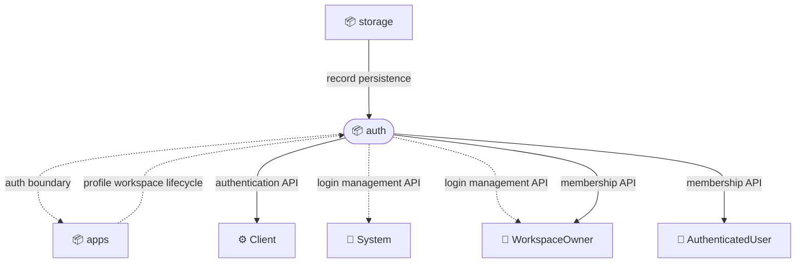
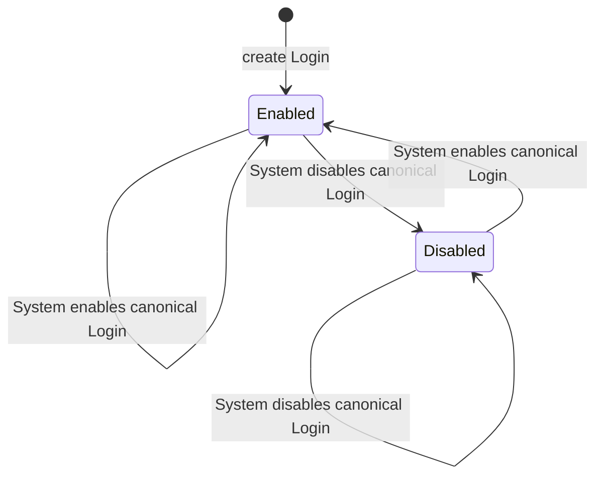
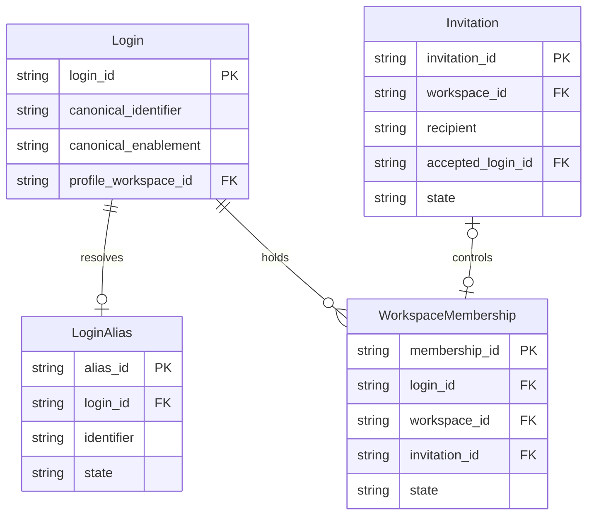

# Bounded Context: auth

## Overview

Auth establishes subject identity, controls access to credentials and tokens, composes principals for authorization, and associates canonical logins with workspace memberships.

Scope:

- Owns Login creation, canonical Login enablement, aliases, credentials, and sign-in eligibility
- Issues, renews, and validates PrincipalToken values and composes Principal values for authorization
- Maintains workspace memberships and their role grants under canonical Login identities
- Exposes trusted Login mutations to System-authorized callers and workspace-scoped Login CDoc reads to registry WorkspaceOwners

Out of scope:

- ProfileWorkspace creation and profile content, which belong to `apps`
- Durable record and event persistence, which belongs to `storage`
- HTTP routing and cluster selection, which belong to `routing`
- Application-specific business operations and ACL declarations

## External actors

Roles:

- 👤 AuthenticatedUser
  - Uses an authenticated identity to access workspaces and manage their own memberships
- 👤 System
  - Performs trusted Login, LoginAlias, role, and canonical enablement management
- 👤 WorkspaceOwner
  - Reads CDocs in owned workspaces and manages memberships in a workspace

Systems:

- ⚙️ Client
  - Creates user or device logins, signs in, manages credentials, and presents PrincipalToken values to Voedger APIs

## Relationships

### Service exposure

Arrows point upstream -> downstream. Edge style encodes the exposure pattern:

- `--->` solid: Open Host Service (ohs) - public, general-purpose contract for many consumers
- `-..->` dotted: Customer-Supplier (c/s) - contract tailored to one or a few known consumers

#### apps -> auth: profile workspace lifecycle (c/s)

Upstream:

- Creates ProfileWorkspace instances for new Login identities and reports their identifiers and readiness
- Supporting design: [application workspace architecture](../apps/arch.md)

Downstream:

- References the ProfileWorkspace from Login
- Requires ProfileWorkspace readiness before issuing the first PrincipalToken

#### storage -> auth: record persistence (ohs)

Upstream:

- Provides durable, workspace-scoped persistence for auth records and lifecycle events
- Supporting design: [structured storage architecture](../storage/structs--arch.md)

Downstream:

- Persists Login, LoginAlias, and WorkspaceMembership state without exposing storage concepts in auth contracts

#### auth: auth boundary (c/s)

Provider:

- Contract: validates a presented `PrincipalToken`, or establishes the reserved Guest identity when no token is presented, and returns `AuthnResult` containing the original payload, effective `Principal` values, and independently eligible enrichment roles for the current request
- Context: the request supplies the target Application and Workspace; these identify the authorization context independently of the token identity and the Workspace references in `RoleGrant`
- Supporting design: [auth context architecture](./arch.md)

Consumers:

- 📦 apps
  - Uses effective `Principal` values for application ACL evaluation and System checks, the original payload for RequestSubject and identity logging, and the original payload plus eligible enrichment roles for token enrichment

#### auth: authentication API (ohs)

Provider:

- Contract: Login creation, sign-in, credential recovery, PrincipalToken issue, and PrincipalToken renewal
- Behavior: [authentication scenarios](./authn.feature)

Consumers:

- ⚙️ Client
  - Establishes and renews user or device identity without learning whether a rejected canonical Login is disabled

#### auth: login management API (c/s)

Provider:

- Contract: trusted LoginAlias, role, and CanonicalLoginEnablement mutation plus full Login CDoc reads
- Authorization: System PrincipalToken for mutations; System or WorkspaceOwner of the target registry workspace for Login CDoc reads

Consumers:

- 👤 System
  - Reads and changes canonical Login state while public callers receive non-disclosing failures
- 👤 WorkspaceOwner
  - Reads the full Login CDoc, including canonical enablement and LoginAlias lifecycle state, only in the target registry workspace it owns

#### auth: membership API (ohs)

Provider:

- Contract: workspace invitation, acceptance, role update, removal, and leave operations
- Behavior: [workspace invitation scenarios](./invites.feature)

Consumers:

- 👤 AuthenticatedUser
  - Accepts invitations and leaves workspaces under their canonical Login identity
- 👤 WorkspaceOwner
  - Invites members, changes granted roles, and removes members

## Model specification

### Entities

#### Invitation (aggregate)

A workspace-scoped offer of roles to a recipient identified by a SignInIdentifier.

References: an inviting workspace and, after acceptance, the canonical `Login` and resulting `WorkspaceMembership`.

Fields:

| Field               | Type                                     | Description                                                        |
| ------------------- | ---------------------------------------- | ------------------------------------------------------------------ |
| `invitation_id`     | `string`                                 | Stable identity of the Invitation                                  |
| `workspace_id`      | `string`                                 | Workspace offering membership                                      |
| `recipient`         | `SignInIdentifier`                       | Canonical or alias identifier to which the Invitation is addressed |
| `roles`             | `RoleSet`                                | Roles offered in the workspace                                     |
| `state`             | `enum(Pending, Joined, Cancelled, Left)` | Current invitation lifecycle state                                 |
| `accepted_login_id` | `string?`                                | Canonical Login that accepted the Invitation                       |

Invariants:

- Only a Login whose canonical SignInIdentifier or active LoginAlias matches the recipient can accept an Invitation.
- Acceptance records the canonical Login identity even when the Invitation was addressed to an alias.
- One active WorkspaceMembership has exactly one controlling joined Invitation.
- Replacing the controlling Invitation preserves one WorkspaceMembership and retires the previous joined Invitation.

#### Login (aggregate)

The canonical registry identity through which a user or device authenticates in an application.

Embeds: `CanonicalLoginEnablement`, `Credential`.
References: an optional active `LoginAlias` and a ProfileWorkspace owned by `apps`.
Referenced by: `WorkspaceMembership`.

Fields:

| Field                  | Type                       | Description                                                                                   |
| ---------------------- | -------------------------- | --------------------------------------------------------------------------------------------- |
| `login_id`             | `string`                   | Stable internal identity of the Login                                                         |
| `canonical_identifier` | `SignInIdentifier`         | Primary sign-in identifier, reserved while the Login remains active                           |
| `subject_kind`         | `enum(User, Device)`       | Kind of subject represented by the Login                                                      |
| `canonical_enablement` | `CanonicalLoginEnablement` | Reversible availability of the canonical SignInIdentifier, independent of registry activation |
| `credential`           | `Credential`               | Current authentication proof or verifier                                                      |
| `active_alias_id`      | `string?`                  | Reference to the active LoginAlias, when one exists                                           |
| `profile_workspace_id` | `string`                   | Reference to the subject's ProfileWorkspace                                                   |

Invariants:

- A newly created Login has `CanonicalLoginEnablement` set to `Enabled`.
- Only `👤 System` can disable or enable the canonical Login, and setting its current state again succeeds without another state change.
- `👤 System` or `👤 WorkspaceOwner` of the target registry workspace can read the full Login CDoc; ownership of another workspace does not grant access.
- A canonically `Disabled` Login remains active in the registry and continues to reserve its canonical `SignInIdentifier`.
- Disabling the canonical Login does not change its Credential, active LoginAlias, ProfileWorkspace reference, or WorkspaceMembership records.
- Issuing a PrincipalToken or initiating password reset through the canonical SignInIdentifier requires `CanonicalLoginEnablement` to be `Enabled`.
- An active LoginAlias remains usable for PrincipalToken issue and password reset regardless of `CanonicalLoginEnablement`.
- Password change, password-reset completion, PrincipalToken validation, and PrincipalToken renewal do not read `CanonicalLoginEnablement`.
- Public canonical sign-in and recovery-initiation contracts do not distinguish a canonically `Disabled` Login from an unknown Login or invalid Credential.

State transitions:

Registry deactivation is a separate lifecycle and is not represented by this enablement state machine.

#### LoginAlias (aggregate)

An alternative SignInIdentifier that resolves to one canonical Login.

References: `Login`.

Fields:

| Field        | Type                     | Description                                                 |
| ------------ | ------------------------ | ----------------------------------------------------------- |
| `alias_id`   | `string`                 | Stable identity of the LoginAlias record                    |
| `login_id`   | `string`                 | Canonical Login resolved by the alias                       |
| `identifier` | `SignInIdentifier`       | Alternative sign-in value                                   |
| `state`      | `enum(Active, Inactive)` | Whether the alias can resolve sign-in and recovery requests |

Invariants:

- A Login has at most one active LoginAlias.
- Canonical and alias SignInIdentifier values share one uniqueness namespace.
- Disabling the canonical Login does not deactivate its active LoginAlias or release the alias identifier.
- An active LoginAlias remains usable for sign-in and recovery while the canonical Login is `Disabled`; clearing the LoginAlias is the only way to disable alias operations.

#### WorkspaceMembership (aggregate)

A Login's role-bearing association with one workspace.

References: `Login` and a workspace owned by `apps`.
Controlled by: one joined `Invitation` while active.

Fields:

| Field           | Type                     | Description                                |
| --------------- | ------------------------ | ------------------------------------------ |
| `membership_id` | `string`                 | Stable identity of the membership          |
| `login_id`      | `string`                 | Canonical Login that holds the membership  |
| `workspace_id`  | `string`                 | Workspace in which roles are granted       |
| `invitation_id` | `string`                 | Controlling joined Invitation              |
| `roles`         | `RoleSet`                | Application roles granted in the workspace |
| `state`         | `enum(Active, Inactive)` | Whether the membership contributes roles   |

Invariants:

- One canonical Login has at most one active WorkspaceMembership in a workspace.
- Canonical Login disablement does not change membership state or roles.
- Access through an active LoginAlias or an existing PrincipalToken continues while the canonical Login is `Disabled`.
- Re-enabling the canonical Login restores its canonical entry operations without recreating memberships.
- Membership roles apply in `workspace_id`, the Workspace containing the assignment
- `sys.Subject.ProfileWSID` references the member identity's ProfileWorkspace; it does not select a Workspace in which to grant a role
- A membership in a foreign Workspace can authorize that Workspace without a carried grant; enrichment in another Workspace does not capture the foreign assignment

### ERD

### Value Objects

#### AuthnResult

The request-local result of authentication, consumed within its target Application and Workspace.

| Field              | Type                     | Description                                                                                                                      |
| ------------------ | ------------------------ | -------------------------------------------------------------------------------------------------------------------------------- |
| `payload`          | `PrincipalToken` payload | Validated original claims, including Subject identity and original RoleGrant values                                              |
| `principals`       | `list<Principal>`        | Effective authorization inputs for this request                                                                                  |
| `enrichment_roles` | `RoleSet`                | Distinct qualified role names independently eligible for new grants under the [PrincipalToken enrichment rules](#principaltoken) |

Invariants:

- Successful token authentication returns the original decoded payload with legacy scopes normalized by validation; composition does not add or rewrite grants in it
- Subject kind, canonical Login, Alias, and ProfileWorkspace remain available even when API-token or System composition omits User or Device Principals
- Anonymous requests use a Guest payload with User kind, canonical Login `sys.Guest`, ProfileWorkspace `GuestWSID`, and no token grants; this synthetic identity does not represent a validated bearer token
- A LoginAlias may resolve Subject-role assignments but does not replace the canonical Login
- Enrichment eligibility is recorded independently of effective-Principal deduplication, so a role shared by a carried grant and an eligible source remains eligible
- A role supplied only by a carried `RoleGrant` can be effective for authorization without appearing in `enrichment_roles`
- API-token authentication skips Subject lookup; API-token and synthetic Guest results have no enrichment roles
- The target Application and Workspace stay in request context; ProfileWorkspace identifies the Subject, while profile and Workspace ownership rules determine the resulting effective roles
- Failed authentication returns no usable partial result

#### CanonicalLoginEnablement

The reversible availability state of a Login's canonical SignInIdentifier.

Values:

- `Enabled` - the canonical SignInIdentifier can issue a PrincipalToken and initiate password reset
- `Disabled` - those two canonical entry operations are rejected while active LoginAlias and all other Login operations remain unchanged

#### Credential

Authentication evidence or stored verifier associated with a Login; secret values are never exposed by public contracts.

Fields:

| Field      | Type                            | Description                                                     |
| ---------- | ------------------------------- | --------------------------------------------------------------- |
| `kind`     | `enum(Password, VerifiedValue)` | Proof mechanism used by an authentication or recovery operation |
| `verifier` | `string`                        | Protected representation used to validate the presented proof   |

#### Principal

An effective authorization input evaluated only in the current request Application and Workspace.

Fields:

| Field  | Type                                    | Description                                            |
| ------ | --------------------------------------- | ------------------------------------------------------ |
| `kind` | `enum(User, Device, Role, Host, Group)` | Principal category                                     |
| `name` | `string`                                | Login, qualified role name, or Host name when relevant |
| `id`   | `string?`                               | Group identifier when relevant                         |

Invariants:

- `Principal` has no Workspace identifier; neither a role's source Workspace nor a Subject's ProfileWorkspace forms part of its value or equality
- Effective Principals are valid only within the request context that produced them and are not transferable authorization inputs for another Application or Workspace
- The original token payload provides identity independently of whether composition emits a User or Device Principal
- Effective Principals alone do not determine enrichment additions; `AuthnResult.enrichment_roles` supplies eligible role names while original grants remain in the payload

#### PrincipalToken

An app-scoped bearer value carrying an immutable identity snapshot until expiration.

Fields:

| Field                  | Type                 | Description                                                                                    |
| ---------------------- | -------------------- | ---------------------------------------------------------------------------------------------- |
| `canonical_login`      | `SignInIdentifier`   | Canonical Login captured when the token is issued                                              |
| `alias`                | `SignInIdentifier?`  | Active LoginAlias captured when the token is issued                                            |
| `subject_kind`         | `enum(User, Device)` | Subject kind captured from Login                                                               |
| `profile_workspace_id` | `string`             | ProfileWorkspace reference captured from Login                                                 |
| `workspace_roles`      | `list<RoleGrant>`    | Role grants captured or enriched into the token, each carrying an explicit applicability scope |
| `global_roles`         | `RoleSet`            | Roles applicable across workspaces                                                             |
| `api_token`            | `boolean`            | Whether restricted API-token principal composition applies                                     |
| `expires_at`           | `timestamp`          | Normal expiration boundary                                                                     |

Invariants:

- PrincipalToken validity depends on signature, application audience, and expiration, not a live Login lookup.
- PrincipalToken validation and renewal do not read `CanonicalLoginEnablement`.
- LoginAlias or canonical enablement changes do not rewrite an already-issued PrincipalToken.
- `api_token` selects restricted principal composition, while each `RoleGrant` carries its applicability through `RoleScope`
- Regular User and Device tokens can carry both `RoleScopeWorkspace` and `RoleScopeWorkspacesOwnedBy` grants
- API tokens retain restricted principal composition, applying only matching `RoleScopeWorkspace` grants alongside the authenticated-user role
- Legacy tokens without explicit role scopes retain the scope implied by their original token kind
- Renewal preserves the original identity claims, GlobalRoles, token kind, and every grant's scope and Workspace binding

Enrichment rules:

- Enrichment requires a valid bearer token and the endpoint's existing authorization
- Enrichment copies the original payload and preserves all carried grants, including grants that did not apply to this request
- For a regular token, each role in `AuthnResult.enrichment_roles` proposes a grant with its qualified role name, `RoleScopeWorkspacesOwnedBy`, and the request Workspace identifier
- A role supplied only by carried grants does not propose another grant, regardless of whether those grants have exact-Workspace or owned-by scope
- Authorization to call the endpoint does not establish enrichment eligibility for each effective role
- A role shared by a carried grant and an independently eligible source still proposes a grant
- An eligible `sys.WorkspaceDevice` role uses the request Workspace for its new grant, not the Device's ProfileWorkspace; carried Device grants keep their original bindings
- API-token enrichment preserves the original identity and grant claims without additions, regardless of effective roles or independent assignments
- Proposed additions are appended only when absent under [RoleGrant equality](#rolegrant); existing duplicate entries are preserved, and a shared role name does not merge grants with different scopes or Workspace bindings
- Repeated enrichment in one Workspace with unchanged independently eligible roles is idempotent
- Re-enrichment in a child cannot extend a carried role to another ownership level unless an eligible source independently supplies that role in the child
- Carried exact-Workspace grants retain their target when enrichment occurs elsewhere; they do not acquire access to the target's parent or children
- Subject identity claims, canonical Login, Alias, GlobalRoles, and token kind are preserved

For regular tokens, each role source contributes to enrichment eligibility as follows:

| Role source                                                                                                | Eligible for a new grant |
| ---------------------------------------------------------------------------------------------------------- | ------------------------ |
| Subject assignment in the request Workspace resolved through canonical Login or the token's captured Alias | Yes                      |
| `PrincipalToken.global_roles`                                                                              | Yes                      |
| Profile ownership                                                                                          | Yes                      |
| Workspace ownership, including ownership-derived `sys.WorkspaceOwner` without a Subject assignment         | Yes                      |
| Device eligibility                                                                                         | Yes                      |
| Derived `sys.System` role                                                                                  | Yes                      |
| Matching carried `RoleGrant`                                                                               | No                       |
| Automatically supplied authentication markers, including `sys.AuthenticatedUser` and `sys.Anonymous`       | No                       |
| ACL inheritance or legacy role expansion alone                                                             | No                       |

#### RoleGrant

An application role assignment whose applicability is determined by `RoleScope` and a Workspace reference.

Fields:

| Field          | Type        | Description                                                   |
| -------------- | ----------- | ------------------------------------------------------------- |
| `scope`        | `RoleScope` | How the Workspace reference determines where the role applies |
| `workspace_id` | `string`    | Workspace reference interpreted according to `scope`          |
| `role`         | `string`    | Qualified application role name                               |

Equality:

- Two `RoleGrant` values are equal only when their `scope`, `workspace_id`, and `role` are all equal

#### RoleScope

An integer discriminator defining the meaning of the Workspace reference carried by `RoleGrant`. Its zero value defaults to `RoleScopeWorkspacesOwnedBy`.

Values:

- `RoleScopeWorkspacesOwnedBy = 0` - the role is emitted in each Workspace whose immediate owner is the referenced Workspace; applicability follows one ownership edge and does not recurse into grandchildren
- `RoleScopeWorkspace = 1` - the role applies only to the referenced Workspace

#### RoleSet

An unordered, duplicate-free set of application role names.

#### SignInIdentifier

A validated value used as either a canonical Login identifier or LoginAlias identifier within one application-wide uniqueness namespace.

#### VerifiedValueToken

A short-lived, single-use Credential proving control of one verified value for a declared authentication or recovery purpose.

Fields:

| Field        | Type        | Description                                   |
| ------------ | ----------- | --------------------------------------------- |
| `value`      | `string`    | Verified value bound to the token             |
| `purpose`    | `string`    | Operation for which the proof can be consumed |
| `expires_at` | `timestamp` | Expiration boundary of the proof              |
